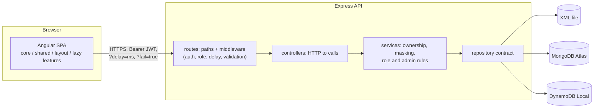

# Chatelaine

[](https://github.com/D-Dynamico/Chatelaine/actions/workflows/ci.yml)

Service requests, scoped to who you are. An Angular single-page app with a TypeScript API,
built as a take-home: role-based sign-in, a dashboard whose data depends on your access
level, user management for admins, and a latency lab that shows how the app handles slow and
failing requests.

In a grand household, the chatelaine wore the ring of keys and decided who could enter which
rooms. The app does the same. **The server holds every key, and each user sees only what
their role opens.** The interface hides what a role cannot use, but hiding is a convenience:
every rule is enforced in the API, and a test proves each one by calling the API directly
with the wrong token.

## Live demo

- App: `<vercel url>`
- API health: `<render url>/api/health`

The API runs on a free instance that sleeps after 15 idle minutes. The first visit can take
about a minute; the app shows the server waking up rather than a blank page.

### Demo accounts

All passwords are `Chatelaine@2026`. The login page lists these as one-click tags.

| User ID | Role | Shows |
|---|---|---|
| `meera.admin` | Admin | Every request, internal notes, user management |
| `vikram.admin` | Admin | A second admin to edit |
| `riya` | General User | Her own requests only; some are Admin-level and hidden from her |
| `arjun` | General User | A short list |
| `sara` | General User | The empty state |
| `kabir` | General User, disabled | Sign-in is refused |

Choose the role that matches the account; a mismatch is refused with the same message as a
wrong password, so the response never says which part was wrong.

## How the brief maps to the app

| Requirement | Where |
|---|---|
| Login with user ID, password and role | Login page; `POST /api/auth/login` checks the role against the stored one |
| Dummy API with XML, MongoDB or DynamoDB storage | All three, behind one repository contract, chosen by `STORAGE` |
| Logged-in page with user details | The access card on the dashboard (`GET /api/me`) |
| Records in a table, showing access level | Service requests table; the server filters by owner and access level and removes restricted fields |
| Admin manages users | `/admin/users`: create, edit, disable, delete, with server-side protections |
| Delay parameter and async processing | `?delay=ms` on every API call; the latency lab sets it per endpoint and draws the request timeline |
| User service and app load | `UserService`/`AuthService` and an app initializer that wakes the API and restores the session |
| Modular code | Core, shared and lazy-loaded feature areas; the admin area is its own chunk |

## Running locally

**Needs:** Node 24 or later (`.nvmrc`), npm and Git. Docker Desktop only if you want the
MongoDB or DynamoDB adapters; the default needs nothing else.

```
git clone https://github.com/D-Dynamico/Chatelaine.git chatelaine
cd chatelaine

# terminal 1: the API on http://localhost:3000
cd api
cp .env.example .env            # PowerShell: Copy-Item .env.example .env
npm ci
npm run seed                    # six users and sixty service requests
npm run dev

# terminal 2: the web app on http://localhost:4200
cd web
npm ci
npm start
```

Open <http://localhost:4200> and use a demo account above. The scripts run unchanged on
Windows and Linux.

### Switching storage

```
STORAGE=file     # default: an XML file in api/data, no setup
STORAGE=mongo    # docker compose up -d mongo     (MONGO_URI=mongodb://localhost:27017)
STORAGE=dynamo   # docker compose up -d dynamodb  (DYNAMO_ENDPOINT=http://localhost:8000)
```

Set it in `api/.env`, then run `npm run seed` again, because each adapter has its own data.
In production the API runs on MongoDB Atlas.

## Architecture



- **The API is layered.** Routes declare paths and middleware, controllers translate HTTP to
  calls, services hold every rule, and repositories only talk to storage. Only repositories
  import a storage SDK, and one contract test suite runs against all three of them.
- **The SPA** is split into `core/` (auth, interceptors, guards, the app initializer),
  `shared/` (presentational components), `layout/` (the shell) and lazy-loaded `features/`
  (`auth`, `dashboard`, `admin`, `latency-lab`). Signals hold state; RxJS handles anything
  over time. A General User never downloads the admin code.
- **On boot** the app pings `/health` (a sleeping free instance can take a minute), then
  restores the session from `/me`. A chain of interceptors attaches the token, appends the
  delay chosen in the lab, logs each request's timing and maps every failure to one error
  shape.

Full detail: [`docs/ARCHITECTURE.md`](docs/ARCHITECTURE.md), [`docs/API.md`](docs/API.md) and
[`docs/FRONTEND.md`](docs/FRONTEND.md).

## The async demo

The brief asks for a delay parameter and asynchronous processing. The app makes both
visible, in the **Timeline** button in the top bar.

1. Open **Timeline** and press **Clear**. The drawer does not cover the page, so you can
   watch the dashboard while it draws.
2. Choose the **Staggered** preset and press **Reload dashboard**. The three panels (access
   card, summary, requests) each finish on their own, in reverse order, and the timeline
   shows each request split into simulated delay, server work and network.
3. Switch the strategy to **All at once** and reload: nothing appears until the slowest call
   finishes, and one failure fails all three. Switch to **One after another** and reload: the
   calls form a staircase, each waiting for the one before.
4. Press **Reload dashboard** twice quickly: the first attempt's bars are struck through as
   cancelled.
5. Arm **Fail the next request** for one endpoint and reload: only that panel shows its
   error, with the real error code, and its **Try again** recovers it.
6. Set a 10 s delay and a 5 s client timeout: the panel shows the timeout, and the timeline
   row ends in a dashed edge.

The delay is a real `?delay=` query parameter that the API validates (0 to 10000 ms; anything
else is a 400), reported back in the `Server-Timing` header.

## Design decisions

Every decision, with the alternatives considered, is in [`docs/DECISIONS.md`](docs/DECISIONS.md).
The ones most worth reading:

| Decision | Why it matters |
|---|---|
| [D11](docs/DECISIONS.md) The role chosen at login must match the stored one | The sign-in screen never reveals which part was wrong |
| [D10](docs/DECISIONS.md) Every request re-loads the user | A disabled or demoted user loses access on their next action, not when the token expires |
| [D7](docs/DECISIONS.md) DynamoDB single-table design | One table, one index, and an honest note on its paging limits |
| [D8](docs/DECISIONS.md) Free hosting with no card | Atlas M0, Render free, Vercel |
| [D22](docs/DECISIONS.md) One `LoadState` type for every async view | Loading, loaded, empty and error cannot be forgotten |
| [D23](docs/DECISIONS.md) and [D35](docs/DECISIONS.md) The latency lab | Three loading strategies, and a drawer that does not hide what it demonstrates |
| [D24](docs/DECISIONS.md) Admin mutations are pessimistic | The UI never shows a state the server refused |
| [D36](docs/DECISIONS.md) The previous sign-in is stored | "Last signed in" is true, not always "just now" |

## Testing

- **API:** supertest route tests, including every access rule called with the wrong role or
  another user's token; service tests; and one **repository contract suite that runs against
  all three adapters**. The suite is 219 tests on the file adapter alone; with MongoDB and
  DynamoDB Local attached (`MONGO_URI`, `DYNAMO_ENDPOINT`) the shared contract adds 70 more.
- **Web:** 303 tests for services (with `HttpTestingController`), interceptors, guards, the
  loading strategies and the components, including keyboard behaviour and the role-dependent
  columns.
- **The tests can fail.** Each access rule and each new behaviour was checked by removing it
  and confirming a named test goes red (`docs/TEST_PLAN.md` §37).
- **CI** runs both packages on every push and pull request: lint, format check, typecheck and
  tests, with MongoDB and DynamoDB Local started from `docker-compose.yml`. In CI the database
  suites fail rather than skip if their database is missing.

```
cd api && npm run lint && npm run format:check && npm run typecheck && npm test
cd web && npm run lint && npm run format:check && npm run typecheck && npm test
```

Details: [`docs/TEST_PLAN.md`](docs/TEST_PLAN.md).

## Known limitations

- DynamoDB listings page and sort in memory after the query; fine for demo data, not for
  large tables (D7).
- Tokens live in `sessionStorage` and cannot be revoked before they expire (D9).
- The last-admin protection narrows, but does not close, a race between two admins demoting
  each other at the same moment (D30).
- The XML file adapter is single-process and is not used in production (D6).
- The demo database allows connections from any address, because Render's free instances have
  no fixed outbound IP. It holds only the demo data above.
- The free API instance sleeps when idle, so a cold start takes about a minute.
- The latency lab's `delay` and `fail` parameters work on every route by design, and are
  switched off with `SIMULATION_ENABLED=false`.

## Future scope

- Refresh tokens and server-side revocation; a same-site cookie via a proxy rewrite
- Cursor paging for DynamoDB
- "View as General User" for admins
- Self sign-up and password reset by email
- Transactions or conditional writes for the admin protections
- End-to-end tests with Playwright
- Internationalisation and server-side rendering

## Repository layout

```
api/     Express 5 + TypeScript (ES modules): routes, controllers, services, repositories
web/     Angular standalone app: core, shared, layout, lazy features
docs/    Design, API, frontend, UI, decisions, workflows, test plan, session notes
```

`docs/SYSTEM_DESIGN.md` maps every section number to its file, and `docs/sessions/` records
what changed in each stage, why, and what nearly broke.
